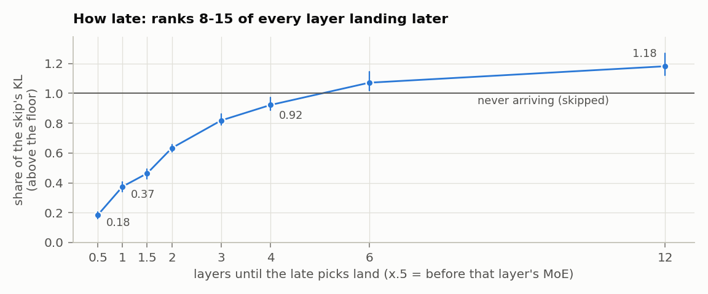
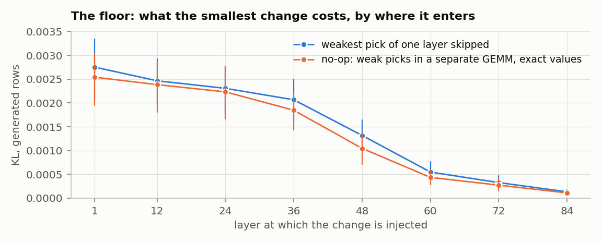
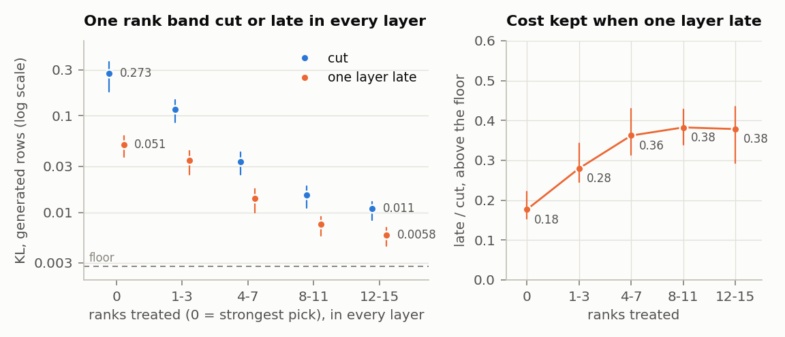
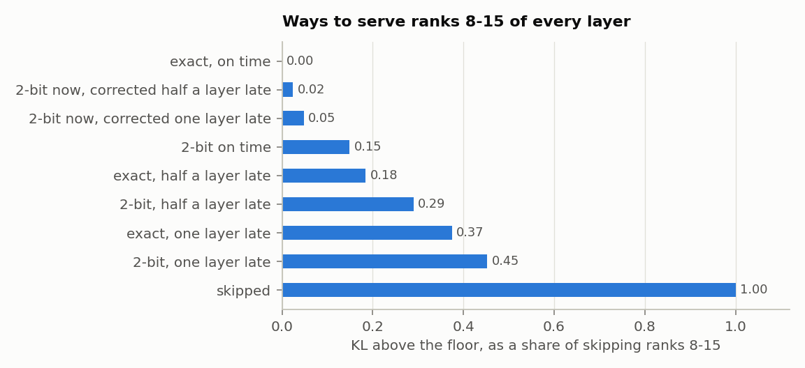
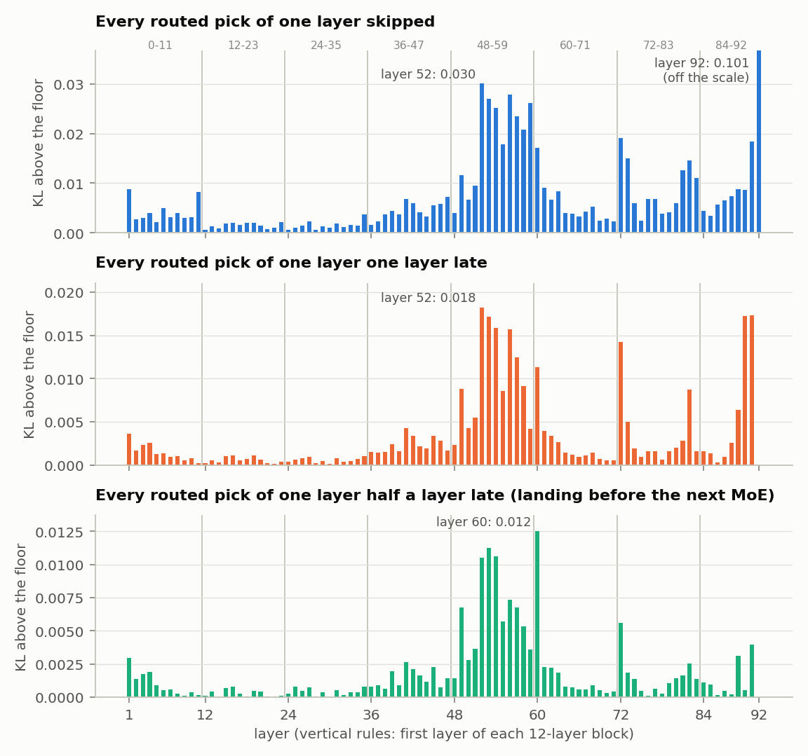
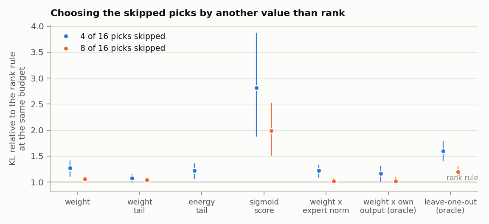
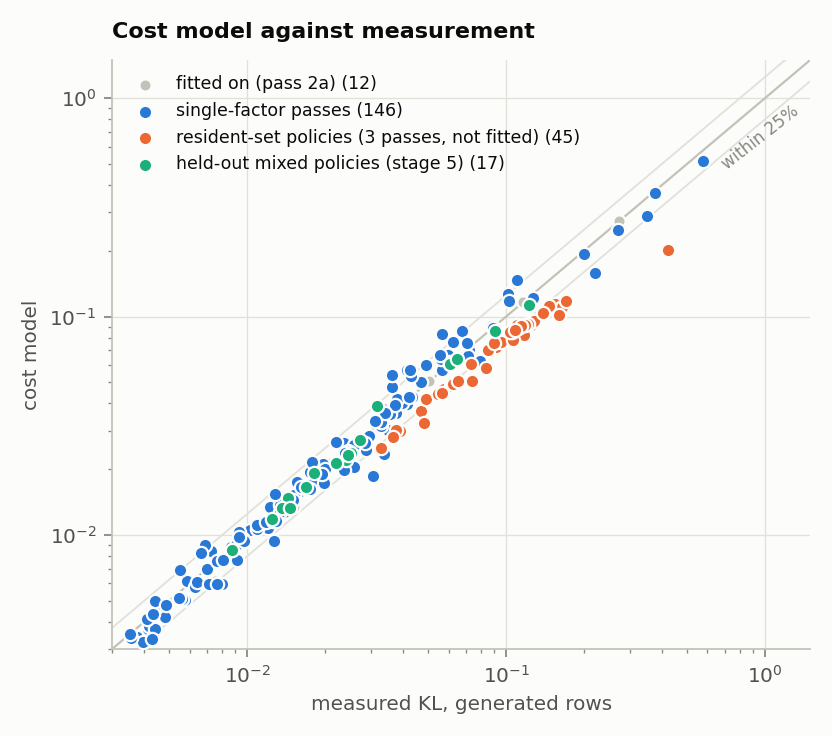

# Kimi K3.1 Pro: what it costs to skip, delay or coarsen a routed expert pick

A reference for engines that serve K3.1 with an expert cache, and the measurements behind derpk31pro's policies ([back to the README](../../README.md#policies)). Measured 2026-11-17 and 18 on the official weights.

Every number is a KL divergence, KL(official || variant), over the full vocabulary, averaged over generated rows of teacher-forced 2,048-token cuts (section 3). Tags: [meas] measured by a pass, [derived] arithmetic on measured figures, [est] estimate. Intervals are 95%, from a bootstrap over source windows. "Above the floor" means after subtracting the floor of section 5.1. Ranks count from 0, the strongest of a token's 16 picks.

## 1. Conclusions

1. **Any deviation costs 0.003 once.** The smallest possible change (one weakest pick skipped in one layer, or a different rounding order) reads 0.0028 [meas]. It is paid once, not per change, and it falls with the depth of the first changed layer (0.0013 at layer 48, 0.0003 at layer 72). Nothing below it can be measured or bought.
2. **The price of a pick is set by its rank, steeply.** Skipped in every layer: rank 0 costs 0.27, ranks 1-3 0.12, ranks 4-7 0.034, ranks 8-11 0.015, ranks 12-15 0.011 [meas]. Rank 0 costs 2.4 times ranks 1-3 at the same removed energy. Below rank 4 the cost follows the removed energy, not the number of picks.
3. **Late is cheaper than skipped, with a deadline.** One layer late keeps 0.16 of the skip cost for rank 0 and 0.35 for ranks 8 and weaker; landing half a layer late (before the next layer's MoE) keeps 0.3-0.5 of the one-layer cost. Two layers late keep 0.63 of the skip cost, four 0.92, and from six layers on arriving is worse than never arriving [meas].
4. **A 2-bit record on time beats waiting.** It costs 0.07-0.15 of skipping, about the same as an exact pick half a layer late. Serving the 2-bit record now and adding the exact correction one layer later costs 0.05 of skipping [meas].
5. **Do not skip into nothing.** Replacing a skipped weak pick by its routing weight times its expert's mean output halves the cost (0.53 [0.47, 0.58] with a table from other text) [meas].
6. **Treatments in one layer do not add; they compound.** Skipped and late picks of one layer add in amplitude: cost = (sum of amplitudes)^1.8. The 8 weakest picks together cost 1.5-1.6 times the two halves singly. 2-bit errors add in cost. Layers add, tokens add [meas, derived].
7. **Sensitivity is very uneven over depth.** Layers 12-35 are nearly free (a whole layer's routed output can be dropped for 0.001-0.002). Layers 48-59 hold a quarter to a third of all sensitivity. Layer 92 is the most sensitive layer for strong picks, layer 91 for weak ones [meas].
8. **Position in the 12-layer block decides whether to defer.** In the last layer of a block a late share costs 0.15 of skipping; in the first layer 0.67. At layers 90 and 91 a whole-layer delay is as bad as skipping or worse, while a half-layer delay there is nearly free [meas].
9. **Gate by rank.** Taking the same number of weakest picks from every token beat every alternative tested at equal budget: a per-layer weight threshold (1.06-1.40x), a cumulative weight tail (1.05-1.08x), the raw sigmoid score (2-3x), an expert-norm table, and two oracles. Thresholds should move with the layer; moving them with the token's routing concentration costs 15-18% in either direction [meas].
10. **Per-layer bands halve the cost at equal budget.** With the same total numbers of on-time, late and skipped picks, bands chosen per layer by the cost model read 0.0316 against 0.0606 for uniform bands (0.52 [0.48, 0.55]; predicted 0.56 before the pass) [meas].
11. **With a resident set, coverage and the cold start set the level.** In a setting with 105 native experts and 400 2-bit records per layer, 35% of picks had no record and were skipped whatever the rule; band boundaries moved the result by 2-7%. The cost in the first 256 rows of a context was 5 times the cost after row 1,024 [meas].
12. **A cost model predicts mixed policies.** Sixteen held-out policies were predicted before they ran at a median 1.04 of the measurement (rms error x1.11, rank correlation 0.98). On resident-set policies it is 20-25% low [meas vs derived].

## 2. The price list

### 2.1 By rank and by way of serving

Excess KL above the floor when the named ranks get the treatment in every layer and on every token. Sixteen cuts (corpus gen16); on 64 further cuts the levels are 1.1-1.2x higher with the same ratios (section 5.9).

| ranks | picks | weight share | skipped | exact, one layer late | exact, half a layer late | 2-bit record on time | 2-bit, one layer late | 2-bit now + exact correction one layer later |
|---|---|---|---|---|---|---|---|---|
| 0 | 1 | 0.158 | 0.271 | 0.048 | 0.018 | 0.019 | | |
| 1-3 | 3 | 0.281 | 0.114 | 0.032 | 0.010 | 0.015 | | |
| 4-7 | 4 | 0.243 | 0.031 | 0.011 | 0.0042 | 0.0070 | | |
| 8-11 | 4 | 0.180 | 0.012 | 0.0048 | | 0.0035 | | |
| 12-15 | 4 | 0.137 | 0.0082 | 0.0031 | | 0.0013 | | |
| 8-15 | 8 | 0.318 | 0.033 | 0.012 | 0.0060 | 0.0049 | 0.0147 | 0.0016 |
| 4-15 | 12 | 0.561 | 0.119 | 0.040 | 0.017 | 0.012 | | |
| all 16 | 16 | 1 | 1.16 [derived] | 0.330 | 0.156 | 0.054 | | |

All [meas] except the last row's first entry, which is the model's extrapolation; the four position classes of all picks skipped sum to 1.15 [meas]. The 2-bit entries for ranks 4-7, 8-11 and 12-15 are differences of nested measurements.

For every rank the order is the same: exact on time < 2-bit now with a late correction < 2-bit on time, about equal to exact half a layer late < exact one layer late < 2-bit late < skipped.

Reference points for the scale [meas]:

| KL | top-1 token agrees with the reference | example |
|---|---|---|
| 0.0028 | 97.4% | the floor |
| 0.011 | 94.9% | 4 weakest picks skipped |
| 0.036 | 91.1% | 8 weakest picks skipped |
| 0.116 | 86.2% | ranks 1-3 skipped |
| 0.273 | 78.1% | rank 0 skipped |

### 2.2 By lateness

Ranks 8-15 of every layer landing d layers later [meas]:

| d (layers) | 0.5 | 1 | 1.5 | 2 | 3 | 4 | 6 | 12 | never |
|---|---|---|---|---|---|---|---|---|---|
| KL | 0.0088 | 0.0150 | 0.0179 | 0.0234 | 0.0294 | 0.0328 | 0.0377 | 0.0413 | 0.0354 |
| share of the skip's excess | 0.19 [0.16, 0.20] | 0.38 [0.34, 0.41] | 0.46 | 0.63 | 0.82 | 0.92 [0.89, 0.97] | 1.07 [1.02, 1.15] | 1.18 [1.12, 1.27] | 1 |



### 2.3 By depth

Share of a treatment's all-layer cost that falls on each block, and the cost per layer relative to the mean layer [meas for the maps, derived for the shares]:

| layers | skipped, ranks 4-15 | skipped, ranks 0-3 | one layer late | 2-bit on time |
|---|---|---|---|---|
| 1-11 | 0.045 (0.37x) | 0.079 (0.66x) | 0.055 (0.46x) | 0.032 (0.27x) |
| 12-23 | 0.037 (0.28x) | 0.016 (0.12x) | 0.023 (0.17x) | 0.022 (0.17x) |
| 24-35 | 0.044 (0.34x) | 0.013 (0.10x) | 0.023 (0.18x) | 0.015 (0.12x) |
| 36-47 | 0.110 (0.84x) | 0.049 (0.37x) | 0.094 (0.72x) | 0.058 (0.44x) |
| 48-59 | 0.245 (1.88x) | 0.347 (2.66x) | 0.407 (3.12x) | 0.253 (1.94x) |
| 60-71 | 0.096 (0.74x) | 0.088 (0.68x) | 0.097 (0.75x) | 0.189 (1.45x) |
| 72-83 | 0.171 (1.31x) | 0.126 (0.97x) | 0.142 (1.09x) | 0.245 (1.88x) |
| 84-91 | 0.228 (2.63x) | 0.032 (0.37x) | 0.159 (1.83x) | 0.166 (1.91x) |
| 92 | 0.024 (2.2x) | 0.249 (23x) | 0 (lands before the output) | 0.021 (1.9x) |

The per-layer values are in the appendix and in `data/layers-table.md`.

### 2.4 How to combine prices

- Inside one layer, skipped picks add in amplitude, and late picks add in amplitude: the cost of a set is (sum of the members' cost^(1/1.8))^1.8. Example: ranks 8-11 (0.012) and 12-15 (0.0082) together cost 0.033, not 0.020.
- A skipped set and a late set in the same layer combine with a coherence of 0.45: cost = (S^2 + T^2 + 0.9 S T)^0.9, S and T the two amplitude sums. Example: ranks 3-11 late and 12-15 skipped reads 0.0606; ranks 3-15 all late reads 0.0605.
- 2-bit costs add to each other and to the rest.
- Layers add (weak picks: within 5-17%, slightly less than additive). Tokens add: a treatment on half of the tokens costs 0.52 of the full excess.
- Add the floor once.

Section 6 gives the full formula and its parameters.

## 3. The model, as it matters here

Kimi K3.1 Pro's text model has 93 decoder layers, numbered 0-92: hidden size 7,168, vocabulary 163,840, 96 attention heads. Layer 0 has a dense MLP; layers 1-92 each have a mixture-of-experts block.

**Attention.** 69 layers use KDA, a gated delta-rule linear attention with a recurrent state; 24 use full attention (MLA): layers 3, 7, 11, ..., 91 and layer 92.

**Attention residuals.** Layers are grouped in blocks of 12 (0-11, 12-23, ..., 84-92). Inside a block a running sum (the prefix) collects the sublayer outputs. At the first layer of a block the prefix is stored as a block state and restarts. Every sublayer reads a learned softmax mixture over all stored block states and the current prefix; so does the output head after layer 92. Consequence: a contribution that arrives late can still be added exactly where it belongs (to the open prefix, or into the stored block state), and every later read sees it. What cannot be repaired is what the sublayers in between computed without it.

**The MoE block.** The normalized layer input is projected from 7,168 to 3,584 dimensions. A sigmoid router with a score bias picks 16 of 896 experts per token and renormalizes their weights to sum to 1. Each expert is a gated MLP of three 3,072 x 3,584 matrices (MXFP4 weights, MXFP8 activations). The weighted sum is RMS-normalized and projected back: `out = up(RMSNorm(sum_i w_i f_i(x)))`. Two shared experts run beside it. Because of the RMSNorm a missing pick changes the direction of the routed output, not its size; the survivors are rescaled to full norm.

**A late pick** is defined here as the share `up(RMSNorm(complete sum)) - up(RMSNorm(sum without it))`, added d layers later. "One layer late" lands after the next layer's MoE; "half a layer late" lands after the next layer's attention and before its MoE.

**Routing statistics** [meas, 32 cuts]. Mean weight share by rank: 0.158, 0.112, 0.091, 0.078, 0.069, 0.063, 0.058, 0.053, 0.050, 0.046, 0.044, 0.041, 0.038, 0.036, 0.033, 0.030. Share of the squared weight ("energy"): 0.293 for rank 0, 0.328 for ranks 1-3, 0.195 for 4-7, 0.114 for 8-11, 0.070 for 12-15. Routing is much flatter in the first layers of blocks 1-4: at layer 12 the strongest pick has weight 0.070 and ranks 8-15 hold 0.47 of the energy; at layer 68 they hold 0.08.

## 4. Measurement

**Metric.** KL(official || variant) over the full vocabulary, per row, in float64, on teacher-forced cuts of 2,048 tokens. The reference is the official W4A8 arithmetic; every variant differs from it by the treatment only. The headline is the mean over generated rows: rows whose predicted token is assistant output or plain text. On prompt, system and tool rows the model's predictions are unstable under any change, so they are computed and not scored.

**Corpus.** Cuts of a public K3.1 evaluation set. gen16: 16 cuts, 8 domains, 32,752 generated rows, 14 source windows (most passes). gen8: 8 of them (per-layer maps). genB-a and genB-b: 64 further cuts, 11 domains, 118,868 generated rows (content, pooled levels). gen32: 32 cuts (screening passes run before the study).

**Universes and passes.** A universe is one variant of the model. All universes of a pass are advanced through the layers together on the same cuts and share the reference, so comparisons inside a pass are paired. A universe is bit-identical to the reference before its first changed layer.

**Statistics.** Means are ratio estimators over rows. Intervals resample source windows (4,000 resamples, the same for every universe of a corpus), so ratios and differences are paired. On gen16 a level is known to about +-20%, a ratio of two universes to +-5-8%. Single-layer values of the maps (8 cuts, floors from separate universes) are good to about +-0.0004.

**Treatments.** Skipped: the pick is left out of the sum. Late: defined above. 2-bit: the expert's weights from a 2-bit record (two bit-planes of the 4-bit codes, the runner's default reconstruction; a centroid reconstruction is 1.28x worse). 2-bit with correction: the 2-bit result now, the exact difference later.

**Checks.**
- The runner's CPU selftest passes in fp32 and bf16 on both hosts used.
- On real weights the new MoE path and the original per-batch path agree as two rounding realizations: each universe within 0.88-1.06 of the other path's KL.
- A universe whose selectors never apply reads exactly 0.
- The same universe run in two passes reproduces to all printed digits.
- Passes ran on two hosts (an ARM64 and an x86-64 machine, same GPU model); the shared anchors agree within the floor's noise (ranks 8-15 skipped 0.0356 and 0.0354; one layer late 0.0145 and 0.0150).

**Design.** Written before any pass (18 hypotheses, listed with their outcomes in section 9). Single-factor passes first (rank bands, lateness, precision, substitutes, maps), gate comparisons at equal budget, then a hold-out pass whose results the cost model predicted in writing beforehand. The complete list of passes is in the appendix.

## 5. Results

### 5.1 The floor

| first changed layer | 1 | 12 | 24 | 36 | 48 | 60 | 72 | 84 |
|---|---|---|---|---|---|---|---|---|
| weakest pick of that layer skipped | 0.00275 | 0.00247 | 0.00231 | 0.00207 | 0.00132 | 0.00055 | 0.00033 | 0.00013 |
| no-op (same values, another GEMM split) | 0.00254 | 0.00238 | 0.00223 | 0.00185 | 0.00105 | 0.00044 | 0.00027 | 0.00011 |

[meas] The two probes agree: the floor depends on where the first change enters, not on what it is. Dense arithmetic accumulated in fp32 reads the same 0.0028. On 80 cuts the floor at layer 1 is 0.0028 [0.0025, 0.0032].

It is paid once: ranks 8-15 skipped reads 0.0356, and the same with fp32 dense arithmetic on top 0.0352 (difference -0.0004 [-0.0011, +0.0002]) [meas].

Mechanism [derived from the logged hidden-state deviation]: any perturbation is amplified by the following layers until every universe's stream differs from the reference by the same amount (a mean relative deviation of 8% by layer 16 and 13-17% by layers 60-72 for the smallest change). At the floor the top-1 token already differs from the reference in 2.6% of generated rows.



### 5.2 Which pick

One rank band treated in every layer [meas; gen16, then pooled over 80 cuts]:

| ranks | skipped, gen16 | skipped, 80 cuts | one layer late, gen16 | one layer late, 80 cuts | late / skipped above the floor, 80 cuts |
|---|---|---|---|---|---|
| 0 | 0.2734 [0.179, 0.360] | 0.326 [0.275, 0.383] | 0.0505 | 0.0531 [0.047, 0.060] | 0.155 [0.144, 0.169] |
| 1-3 | 0.1163 [0.085, 0.146] | 0.136 [0.118, 0.155] | 0.0345 | 0.0333 [0.030, 0.037] | 0.230 [0.213, 0.247] |
| 4-7 | 0.0335 [0.024, 0.042] | 0.0360 [0.032, 0.040] | 0.0139 | 0.0136 [0.012, 0.015] | 0.326 [0.307, 0.347] |
| 8-11 | 0.0152 [0.011, 0.019] | 0.0176 [0.016, 0.020] | 0.0075 | 0.0080 [0.007, 0.009] | 0.347 [0.329, 0.364] |
| 12-15 | 0.0109 [0.008, 0.013] | 0.0120 [0.011, 0.013] | 0.0058 | 0.0062 [0.0056, 0.0069] | 0.366 [0.339, 0.390] |
| 8-15 | 0.0356 [0.028, 0.042] | 0.0396 [0.036, 0.044] | 0.0145 | 0.0156 [0.014, 0.017] | 0.346 [0.335, 0.357] |



- **Per pick** [derived]: rank 0 costs 0.271 above the floor, one pick of ranks 1-3 0.038, of ranks 4-7 0.0077, of 8-11 0.0031, of 12-15 0.0020. A factor of 130 from bottom to top.
- **Rank 0 is special** [meas]. At the same removed energy and the same change of the routed output (0.46 against 0.47 of its norm), skipping rank 0 costs 2.44 [2.29, 2.58] times skipping ranks 1-3. The weak bands are more aligned with the rest of the sum (cosine 0.45) than rank 0 (0.28), so part of their removal is undone by the RMSNorm; beyond that, a change along the strongest expert's direction is worth about six times a change of the same size from the weak bands [derived].
- **Below rank 4 energy is the dose** [meas]: ranks 4-7 (4 picks) cost 0.90 [0.86, 0.95] of ranks 8-15 (8 picks) at nearly the same energy; ranks 8-11 cost 1.61 [1.55, 1.67] times ranks 12-15 at an energy ratio of 1.63.
- **Skip thresholds** [meas]: every pick from rank r on skipped: r = 14: 0.0054, 13: 0.0081, 12: 0.0109, 11: 0.0152, 10: 0.0200, 8: 0.0356, 4: 0.121. In amplitude the six weakest ranks are about equal, so the cost of skipping the n weakest picks grows like n^1.8.
- **Late thresholds** [meas]: every pick from rank r on one layer late: r = 8: 0.0150, 5: 0.0311, 4: 0.0421, 3: 0.0605, 2: 0.0887, 0: 0.333.
- **Delay helps the strong picks most in relative terms and least in absolute terms**: rank 0 one layer late (0.051) still costs more than ranks 4-7 skipped (0.034).
- **Who pays** [meas, correlational]: rows of tokens with peaked routing cost more under every treatment; beyond that baseline only the strong bands depend on concentration (rank 0 skipped: 1.89x the mean in the most peaked fifth of tokens, 0.43x in the flattest).

### 5.3 How late, and where it lands

- The lateness table is in section 2.2. Ranks 4-15: half a layer 0.0197 (0.14 of the skip), one layer 0.0426 (0.34), two layers 0.0717 (0.58) [meas].
- **Half-layer landing** keeps this share of the one-layer cost [meas]: ranks 8-15 0.49; ranks 4-15 0.43; ranks 4-7 0.38; ranks 1-3 0.32; rank 0 0.39; all 16 picks 0.48. Rank 0 half a layer late reads 0.0211, against 0.0505 one layer late and 0.2734 skipped.
- **Per layer** (all picks of one layer, 91 layers) [meas]: half / one layer is 0.55 in the sum; 0.64-0.69 at positions 0-3 of a block, 0.37-0.43 at positions 6-7. At a block's first layer the gain can vanish (layer 60: 0.0125 half, 0.0113 one layer).
- **The last layers** [meas]: a whole-layer delay costs 0.0172 at layer 90 (skipping costs 0.0086) and 0.0173 at layer 91 (0.0184). A half-layer delay there costs 0.0005 and 0.0040. The damage of a late share in the last layers is done by the next layer's MoE, not by its attention.
- **Layer 92**: a late share lands before the output read, which is exact; an engine gets this only if it completes the share before the head.

### 5.4 Reduced precision

- 2-bit records on time, every pick from rank r on [meas]: r = 12: 0.0041, 8: 0.0076, 4: 0.0147, 1: 0.0329, 0: 0.0567 [0.037, 0.078]. Rank 0 alone 0.0220, ranks 1-3 alone 0.0181.
- **2-bit errors of different picks are independent noise** [meas]: rank 0 alone + ranks 1-3 alone + ranks 4-15 = 0.0465 above the floor, all together 0.0540 (1.16x). Skipped bands in one layer are 1.5-3.3x their sum.
- A strong pick's 2-bit error costs more per unit of weight than a weak pick's, but still 14 times less than skipping rank 0 and 2.5 times less than delaying it one layer.
- **Late correction** [meas, ranks 8-15]: 2-bit now and the exact difference half a layer later 0.0008 above the floor, one layer later 0.0016 (2-5% of skipping).
- **2-bit late** costs about the exact late cost plus the 2-bit cost: 0.0147 one layer, 0.0095 half a layer.
- **3 bits** instead of 2 [meas]: 0.43 [0.41, 0.45] of the 2-bit cost with every pick; the gain is in ranks 0-3 (0.23); for ranks 4-15 none (1.11 [0.99, 1.27]).
- **By depth** [meas]: every pick at 2 bits in one block costs 0.0009-0.0034 in each of the blocks of layers 1-47 and 0.011-0.015 in each block from 48 on. Half of the layers take 2-bit records for 13% of the cost. Blocks add (0.92), and position in the block does not matter.



### 5.5 Instead of skipping

| substitute for the skipped picks | ranks 8-15 | ranks 4-15 | ranks 12-15 |
|---|---|---|---|
| nothing (skipped) | 0.0354 | 0.1204 | 0.0109 |
| weight x expert's mean output, table from the same cuts | 0.0191 (0.50) | 0.0793 (0.65) | |
| weight x expert's mean output, table from 32 other cuts | 0.0201 (0.53 [0.47, 0.58]) | 0.0870 (0.72 [0.64, 0.78]) | 0.0070 (0.52) |
| surviving weights rescaled to the original sum | 0.0354 (1.00) | | |

[meas; in brackets the share of the skip's excess] The table is one vector of 3,584 numbers per expert and layer. It does not help for strong picks: every pick of layers 12-23 replaced by mean outputs reads 0.0252, no better than skipping them all (0.0236).

### 5.6 Where in the model

Every routed pick of one layer skipped, or one layer late, or half a layer late; and the 12 weakest picks of one layer skipped [meas, 8 cuts; the per-layer table is in the appendix].



| layers | all 16 skipped, mean per layer | all 16 one layer late, mean per layer | late / skipped | 12 weakest skipped, mean per layer |
|---|---|---|---|---|
| 1-11 | 0.0043 | 0.0014 | 0.34 | 0.0006 |
| 12-23 | 0.0013 | 0.0004 | 0.33 | 0.0005 |
| 24-35 | 0.0015 | 0.0006 | 0.39 | 0.0006 |
| 36-47 | 0.0045 | 0.0023 | 0.52 | 0.0014 |
| 48-59 | 0.0192 | 0.0102 | 0.53 | 0.0032 |
| 60-71 | 0.0058 | 0.0024 | 0.42 | 0.0012 |
| 72-83 | 0.0090 | 0.0035 | 0.39 | 0.0022 |
| 84-91 | 0.0078 | 0.0060 | 0.77 | 0.0040 |
| 92 | 0.1009 | 0 | | 0.0037 |

- **Totals** [meas]: the 92 single layers sum to 0.71 (all 16 skipped), 0.30 (all 16 one layer late) and 0.150 (12 weakest skipped).
- **Most sensitive layers, all picks**: 92 (0.101), 52 (0.030), 56, 53, 59, 54, 57, 58 (0.021-0.028), 72 (0.019), 91 (0.018). Least: 12 (0.0005), 24, 28, 21, 14 (under 0.001).
- **Most sensitive layers, weak picks**: 91 (0.0177, 12% of the total), 72 (0.0063), 53 (0.0047), 90 (0.0045), 59, 54, 83, 92, 57, 89. Layer 92's sensitivity is in its strong picks; layer 91's is in its weak picks as well.
- **The weak-pick profile follows the all-pick profile** (correlation of the logs 0.85) but is flatter: for the weak picks layers 12-47 carry 19% of the sensitivity (13% for all picks) and 48-59 25% (33%).
- **Position in the block** [meas]: last layer of a block (11, 23, ..., 83): late 0.0013 per layer against 0.0087 skipped (0.15). First layer (12, 24, ..., 84): 0.0045 against 0.0067 (0.67). Positions 1-10: 0.48. Reason [derived from the logged mixing weights]: the first layer of the next block reads the just-stored block mostly through its attention and hardly through its MoE, so a share that completes the stored state one layer late has missed little; after a block start the prefix is short and one MoE output is a large part of what the next sublayers read.
- **The attention kind of the next layer does not matter** (late / skipped 0.45 before a KDA layer, 0.46 before a full-attention layer, layers 90-92 left out).
- **The profile carries over to the weak picks at block and class resolution** [meas]: ranks 8-15 skipped by position class (0-1 / 2-4 / 5-8 / 9-11) have shares 0.12 / 0.22 / 0.44 / 0.22; the all-picks map summed over the same classes gives 0.14 / 0.18 / 0.45 / 0.23.

### 5.7 Combining treatments

| test | result [meas] |
|---|---|
| ranks 8-15 together / ranks 8-11 + 12-15 singly (skipped) | 1.60 on gen16, 1.54 on 80 cuts |
| ranks 4-15 together / three bands singly (skipped) | 2.3 |
| all 16 one layer late / five bands singly | 3.3 |
| 2-bit: all picks / rank 0 + ranks 1-3 + ranks 4-15 singly | 1.16 |
| ranks 3-11 late + 12-15 skipped, against ranks 3-15 late | 0.0606 against 0.0605 |
| four position classes (ranks 8-15 skipped) / all layers at once | sum 0.0316, at once 0.0329 (1.04) |
| layers 1-47 + layers 48-92 (ranks 8-15 skipped) | floor + excesses 0.0374, at once 0.0354 (0.95) |
| four single blocks of layers 1-47 | predicted 0.0123, measured 0.0102 (0.83) |
| three separate blocks together | 0.0198 against 0.0214 from the single blocks (0.92) |
| even layers + odd layers, one layer late (ranks 8-15; 4-15) | 1.01; 1.03 |
| 12 weakest skipped in a whole block / its single layers (48-59; 72-83) | 0.89; 0.97 |
| all 16 skipped in a whole block / its single layers (48-59; 72-83) | 1.6; 2.0 |
| ranks 8-15 skipped on 50% / 25% of the tokens | 0.52 / 0.27 of the full excess |

- For the picks an engine would actually skip or defer, layers add, neighbouring delays do not interact, and tokens add.
- Only the removal of a layer's whole routed output compounds across neighbouring layers.
- **Two thirds of the damage is in later rows** [meas]: with half of the tokens treated, rows whose own token was treated read 0.69 of the full excess and rows whose token was not treated 0.36. About one third of a skipped pick's damage falls on its own row; the rest reaches later rows through attention.

### 5.8 Gate thresholds

**Question.** A scheduler sorts each pick whose expert is not ready into on time, late, or skipped. Which value should decide, at what thresholds, and should they depend on the layer or on the token?

**Skipping only, all picks, equal budget in every layer** [meas; paired ratio to the rank rule]:

| picks skipped of 16 | rank rule, KL | per-layer weight threshold | cumulative weight tail | sigmoid score | weight x expert norm (table) | weight x own output (oracle) | leave-one-out (oracle) |
|---|---|---|---|---|---|---|---|
| 2 | 0.0054 | 1.40 [1.20, 1.59] | | | | | |
| 4 | 0.0109 | 1.27 [1.11, 1.41] | 1.08 [0.99, 1.15] | 2.81 [1.88, 3.87] | 1.22 [1.09, 1.33] | 1.17 [1.01, 1.31] | 1.60 [1.41, 1.79] |
| 6 | 0.0200 | 1.19 [1.11, 1.25] | | | | | |
| 8 | 0.0356 | 1.06 [1.00, 1.11] | 1.05 [1.00, 1.09] | 1.99 [1.52, 2.52] | 1.02 [0.96, 1.07] | 1.02 [0.96, 1.09] | 1.20 [1.13, 1.30] |



- **Nothing beats the same number of weakest picks from every token.** The reason is the convexity of section 5.7: what one token loses enters with the power 1.8, so an even spread over tokens is best. A weight threshold removes less weight in total (0.124 against 0.137 at 4 of 16) but takes 0 to 10 picks per token.
- **Concentration** [meas]: the rank rule shifted so that peaked tokens lose 6 picks and flat tokens 2 (same total) costs 1.15 [1.06, 1.23]; the reverse 1.18 [1.13, 1.25]. Do not make the threshold depend on the token.
- **Energy tail** at 4 of 16: 1.22 [1.06, 1.35]. A cumulative-weight tail matched to the removed weight of a rank threshold is 6-10% worse.
- **Predictions** written before the pass, from the amplitude rule at the token level, held: no gate better than rank; the weight threshold between a tie and +40%; the score about 2x. The one miss: a weight tail was predicted up to 10% better and is 5-8% worse.

**Three-way split, all picks** (ranks 0-2 on time, 3-11 one layer late, 12-15 skipped; exact arithmetic) [meas]: 0.0606 [0.048, 0.071]. The same budgets chosen by weight: 0.98 [0.88, 1.04]. By sigmoid score: 1.45 [1.23, 1.69]. By the own-output oracle: 0.93 [0.86, 1.00]. By leave-one-out: 1.11 [1.02, 1.21]. With half-layer landing 0.0327 (0.54); with the late picks at 2 bits 0.0707 (1.17).

**One global threshold for all layers** [meas]: worse than per-layer thresholds: 1.05 [1.03, 1.08] on the three-way split; for skipping, 0.0195 against 0.0139 per layer and 0.0109 by rank. It moves the budget between layers the wrong way (it would skip 10% of the picks of layers 24-35 and 42% of layers 60-71).

**Weight thresholds equivalent to rank bands** [derived from the reference's routing], for engines that prefer a weight test. Weakest 4 of 16: weight share below 0.038 in layers 1-11, 0.042 in 12-23, 0.049 in 24-35, 0.045 in 36-47, 0.040 in 48-59, 0.032 in 60-71, 0.034 in 72-92. Strongest 3 of 16: above 0.077-0.080 in layers 1-47, 0.083 in 48-59, 0.086-0.090 in 60-92.

**Layer dependence.** This is where the gain is: sections 5.6 and 6.3.

**Answer.** Decide by rank within the token. Set the two boundaries per layer. Do not use the raw sigmoid score. A table of expert norms or a predictor of the pick's output is not worth building.

### 5.9 Resident-set policies and content

**The planner's setting** [meas]: 105 native experts per layer, 0.1 promotions per layer and token, 400 experts per layer with a 2-bit record. 44% of all picks are resident (79% of rank 0, 16% of rank 15); 35% have no record and are skipped whatever the rule; the rule sorts the remaining 20%.

| rule for the non-resident picks with a record | KL [95%] | ratio to the planner's rule (paired) |
|---|---|---|
| all skipped | 0.4222 [0.265, 0.590] | 3.79 [3.46, 4.42] |
| all 2-bit, one layer late | 0.1388 | 1.24 [1.20, 1.32] |
| planner: ranks 0-2 2-bit on time, 3-11 2-bit one layer late, 12-15 skipped | 0.1115 [0.066, 0.164] | 1 |
| the same budgets by weight | 0.1121 | 1.005 [0.978, 1.021] |
| the same by sigmoid score | 0.1210 | 1.085 [1.051, 1.111] |
| the same by the leave-one-out oracle | 0.1103 | 0.989 [0.929, 1.022] |
| planner bands, half-layer landing | 0.1051 | 0.943 [0.903, 0.967] |
| late from rank 2 | 0.1187 | 1.065 [1.045, 1.088] |
| on time through rank 4 | 0.1037 | 0.930 [0.884, 0.956] |
| skipped from rank 10 / from rank 14 | 0.1144 / 0.1087 | 1.026 / 0.975 |
| all 2-bit on time | 0.0897 | 0.805 [0.718, 0.854] |

- The gate value does not matter here, and band boundaries move the result by 2-7%.
- The picks without a record set the level. A screening pass with 700 records instead of 400 read 0.48 of the 400-record policy, and faster promotion (0.25 per layer and token) 0.59-0.75 [meas, 32 cuts].
- **Cold start** [meas]: the planner's rule reads 0.341 on rows 0-255, 0.100 on rows 256-1,023 and 0.063 from row 1,024 on. Plain rank cuts fall by 1.6-1.9x over the same span; cache policies by 5-6x.

**Content** [meas, 80 cuts unless noted]:

- The price list is the same on three disjoint sets of text. Ratio to "ranks 8-15 skipped" on gen16 / genB-a / genB-b: rank 0 skipped 7.7 / 8.8 / 7.9; ranks 1-3 3.3 / 3.6 / 3.4; 4-7 0.94 / 0.90 / 0.90; 12-15 0.31 / 0.30 / 0.31; rank 0 late 1.42 / 1.31 / 1.33; ranks 8-15 late 0.41 / 0.38 / 0.40.
- **Domains**, multiplier on "ranks 8-15 skipped" (6-8 cuts each): pretraining text 1.52 [1.23, 1.98]; legal 1.43 [1.22, 1.72]; code 1.29 [1.10, 1.48]; safety 1.24; chat 1.03; software engineering 0.91; agentic 0.82; multilingual 0.81; science 0.75; math 0.66 [0.51, 0.80]; long-context retrieval 0.20 [0.09, 0.43]. For rank 0 skipped the spread is wider (2.19 to 0.18).
- **Late / skipped** for ranks 8-15 is 0.35-0.42 in nine domains, 0.46 in software engineering and 0.57 in long-context retrieval.
- **Kind of row**: plain text 1.5-2.1x the mean; thinking 0.7-0.9x; answer text 0.6-0.8x; tool calls 0.3-0.4x. Plain text against assistant rows: 1.7x for ranks 8-15 skipped, 2.9x for rank 0 skipped.
- **Position in the context**: rows 0-255 cost 1.6-2.5x rows after 1,024 (gen16).
- **Where the KL sits** [meas, 32 cuts, screening pass]: rows where the reference's top probability is at least 0.999 are 22% of the rows and 0.1-0.2% of the KL. Rows whose target can be copied from the context read 0.3x the mean at equal reference entropy. The top 1% of rows hold 15-28% of a universe's KL; the median row is about a quarter of the mean.

### 5.10 Layer reordering

Two adjacent whole layers exchanged (attention, shared and routed experts), 77 pairs inside blocks [meas, 8 cuts].

| layers | mean cost of a swap |
|---|---|
| 1-11 | 0.0109 (0.002-0.051) |
| 12-23 | 0.0011 |
| 24-35 | 0.0023 |
| 36-47 | 0.0062 |
| 48-59 | 0.0311 |
| 60-71 | 0.0120 |
| 72-83 | 0.0184 |
| 84-87 | 0.0094 |
| 88-89, 89-90, 90-91, 91-92 | 0.099, 0.72, 6.0, 5.9 |

Without the last four pairs, the swap cost follows the single-layer maps across layers (correlation of the logs 0.74 with "routed picks one layer late", 0.82 with "routed picks skipped"). A swap costs a median 4.2 times the delay of the first layer's routed picks and 1.5 times skipping them. Layers that tolerate reordering are the layers that tolerate deferral; the last four layers tolerate neither reordering nor a whole-layer delay.

## 6. A cost model for a scheduler

### 6.1 Form

```
KL = f(first changed layer)
   + sum over layers L of [ (S_L^2 + T_L^2 + 2 rho S_L T_L)^(q/2) + B_L ]

S_L = sum over skipped picks k of  s_group(k)[L] * a_k        (a mean-output substitute multiplies a_k by 0.68)
T_L = sum over late picks k of     t[L] * b_k * mu(d, k)
B_L = g2[L] * sum over 2-bit picks k of e_k                   (2-bit late: the pick is in T_L and in B_L)
```

- `q = 1.80`, fitted on five nested sets of pass 2a (within 0.85-1.15). `rho = 0.45`, fitted on one universe.
- `a_k`, `b_k`: amplitudes of rank k skipped / one layer late = (its stand-alone cost)^(1/q).
- `s[L]`, `t[L]`, `g2[L]`: layer scales, the (1/q)-th power of the layer's share of the per-layer maps (for `g2` the share itself). The skip scale differs for ranks 0-3 and ranks 4-15.
- `mu`: lateness factor relative to one layer.
- If a rank is treated in only a fraction p of the tokens (a resident set), replace the amplitude sum by its mean m and add its variance v: (m^2 + v)^(q/2), with v = sum of p (1 - p) amplitude^2.
- All parameters are in `data/model2.json`.

### 6.2 Parameters

| rank | a_k (skipped) | b_k (one layer late) | half-layer factor on b_k | e_k (2-bit, cost) |
|---|---|---|---|---|
| 0 | 0.484 | 0.185 | 0.59 | 0.0239 |
| 1 | 0.119 | 0.059 | 0.53 | 0.0085 |
| 2 | 0.097 | 0.048 | 0.53 | 0.0056 |
| 3 | 0.083 | 0.041 | 0.53 | 0.0041 |
| 4 | 0.045 | 0.024 | 0.58 | 0.0023 |
| 5 | 0.040 | 0.021 | 0.58 | 0.0019 |
| 6 | 0.037 | 0.020 | 0.58 | 0.0016 |
| 7 | 0.034 | 0.018 | 0.58 | 0.0013 |
| 8 | 0.023 | 0.011 | 0.68 | 0.0011 |
| 9 | 0.022 | 0.011 | 0.68 | 0.0009 |
| 10-11 | 0.0175 | 0.011 | 0.68 | 0.0008, 0.0007 |
| 12-15 | 0.0175 | 0.011 | 0.68 | 0.0004-0.0003 |

[derived from passes 2a, 2c, 2d, 7a, 7b]

- Lateness factor on b_k for d = 1.5, 2, 3, 4, 6, 12 layers: 1.13, 1.34, 1.54, 1.65, 1.79, 1.89.
- 3 bits: e_k x 0.2 for ranks 0-3, unchanged for ranks 4-15. Centroid reconstruction: e_k x 1.28. 2-bit with a correction one layer late: 0.32 e_k, on the late profile.
- Layer shares by block: section 2.3; per layer in `data/model2.json`.
- Floor by first changed layer: section 5.1.

### 6.3 Per-layer bands

At a fixed budget (3 picks on time, 9 one layer late, 4 skipped per token and layer on average), the model's per-layer bands against uniform bands, all picks, exact arithmetic [meas; predictions written before each pass]:

| bands | measured [95%] | predicted | ratio to uniform (paired) |
|---|---|---|---|
| uniform: ranks 0-2 on time, 3-11 late, 12-15 skipped | 0.0606 [0.048, 0.071] | 0.0604 | 1 |
| per-layer bands (`data/layer-opt.json`) | 0.0316 [0.025, 0.038] | 0.0391 | 0.52 [0.48, 0.55] |
| the same with on time capped at 4 per layer | 0.0487 [0.038, 0.057] | 0.0547 | 0.80 [0.78, 0.82] |
| re-optimized with at most 4 on time (`data/layer-opt-cap4.json`) | 0.0454 [0.036, 0.053] | 0.0439 | 0.75 [0.73, 0.77] |
| capped bands, late class skipped in the last layer of each block | 0.0569 [0.044, 0.068] | 0.0574 | 0.94 [0.89, 0.97] |
| uniform bands, late class skipped in the last layer of each block | 0.0727 [0.057, 0.086] | 0.0728 | 1.20 [1.17, 1.23] |

Shape of the unconstrained bands: 0-1 picks on time in layers 12-35 and skipping from rank 4-12 there; 7-10 on time in layers 52-58; 8-9 on time at layers 49, 60, 72, 82, 90, 91; nothing skipped and everything else late in the last layer of a block; no late class at layer 90. The bands per layer are in the appendix.

A cap of 4 on-time picks per layer costs half of the gain. Not deferring in the last layer of a block costs 20-25%.

### 6.4 How well it predicts

| passes | universes | model / measured, median | rms error |
|---|---|---|---|
| rank bands (fitted on) | 12 | 1.00 | x1.08 |
| lateness, precision (their factors fitted on) | 29 | 0.97-1.00 | x1.03-1.08 |
| screening passes: thresholds, blocks, position classes | 30 | 0.90-0.98 | x1.07-1.23 |
| dose inside blocks; additivity; rank by position; 2-bit by depth | 51 | 0.93-0.99 | x1.10-1.23 |
| gates (skip and three-way) | 42 | 1.00-1.03 | x1.16-1.19 |
| **hold-out: 16 mixed policies, predicted before the pass** | 16 | **1.04** | **x1.11** |
| the same after fitting rho on another pass, still before the pass finished | 16 | 0.99 | x1.07 |
| capped per-layer bands, predicted before the pass | 6 | 1.00 | x1.10 |
| rank bands on 64 other cuts | 28 | 0.89-0.90 | x1.16-1.19 |
| resident-set policies, three passes, 45 policies | 45 | 0.74-0.80 | x1.32-1.36 |

[meas vs derived] 

- The hold-out: ten random mixes (each block one of eight treatments) measured 0.0124-0.0272, each predicted within 0.99-1.09; 15 of 16 predictions within 25%; rank correlation 0.98.
- On other text the model carries gen16's level; those corpora read 1.1-1.2x.
- **Resident-set policies are under-predicted by a steady 20-25%**, and "every non-resident pick skipped" by 2x. The model sees per-layer counts of treated picks; the misses cluster in the cold rows of each cut. Multiply by 1.25-1.3 for a cold-started cache [est], or measure.

## 7. Practical rules for an engine

1. **Rank 0 on time, always.** If its expert is not ready, a 2-bit record on time (0.019) or the exact pick half a layer late (0.018) costs 14 times less than skipping; one layer late 0.048.
2. **Serve from a 2-bit record on time before deferring**, at every rank. Where both are possible, 2-bit now and the exact correction one layer later is nearly free.
3. **Defer with a deadline**: half a layer if possible, one layer otherwise, never more than two. Beyond four layers drop the pick.
4. **Never skip into nothing**: add weight x mean output for skipped weak picks. This matters most for picks that have no record at all.
5. **Decide by rank within the token**; set the on-time and skip boundaries per layer (`data/layer-opt.json`, or `data/layer-opt-cap4.json` with at most 4 on-time picks).
6. **Spend on-time slots in layers 49-60, 72, 82 and 88-92.** Layers 12-35 need 0-1 picks on time and tolerate skipping from rank 4-10.
7. **Defer in the last layer of every block** (complete the stored block state in place). It is the cheapest deferral in the model, and skipping there is among the most expensive choices in its block.
8. **Avoid deferral in the first layer of a block** when a 2-bit record can be on time instead; half-layer landing gains little there.
9. **At layers 90 and 91** use half-layer landing or no deferral. **At layer 92** complete every pick before the output head.
10. **Put 2-bit records where they are free**: layers 1-47 take them for 13% of the cost.
11. **With a cache, raise coverage first** (more experts with any record, faster promotion), then tune bands; warm the resident set before the first rows of a context if you can.
12. **Budget in amplitudes, not in costs**: the n-th treated pick of a layer costs more than the first. Spread what must be lost evenly over tokens and across layers in proportion to the profile of section 2.3.

## 8. Limits

- **Teacher forcing.** Every row is scored on the reference's context. A late share lands at a later layer of the same position; landing at a later token (decode-time deferral across steps) was not measured, nor was free-running generation or task quality.
- **Context length.** 2,048-token cuts; the model's sparse attention is dense at this length. Cache policies were not followed beyond row 2,047.
- **The per-layer bands** were optimized and measured on all picks at exact precision. In a resident-set setting with 2-bit records the levels differ, and the bands were not measured there.
- **Mean-output substitute**: measured on rank bands of all picks, not on the picks without a record in a cache policy.
- **Resolution.** Single layers are resolved for heavy treatments only (all 16 picks, or the 12 weakest). Profiles for strong picks alone and for late weak picks are known at block and position-class resolution. Single-layer values carry +-0.0004; in layers 1-35 that is the size of the weak-pick signal, so the early-layer entries of the bands are the least certain.
- **Levels** are known to +-10% on 80 cuts and +-20% on 16; ratios to +-5-8%. Content moves levels by 0.2-1.5x (domain) and about 2x (position in the context).
- **The model's cold-start gap** (20-25% low on cache policies) is described, not modeled.
- **Not covered**: which experts (beyond rank and weight), image inputs, speculative draft rows, 2-bit record formats beyond two reconstructions.

## 9. Hypotheses of the design, and what became of them

| # | hypothesis | outcome |
|---|---|---|
| H1 | a floor paid once, falling with depth | confirmed |
| H2 | equal removed energy costs the same | refuted for rank 0 (2.4x); holds below rank 4 |
| H3 | removed picks act coherently; a mean substitute removes part | confirmed (1.5-3.3x; 0.53) |
| H4 | the late penalty saturates below 1 | refuted: it crosses 1 near 5 layers |
| H5 | the late penalty does not depend on the rank | refuted: 0.16 to 0.37 |
| H6 | block starts are most sensitive | true for lateness, not for skipping |
| H7 | block 48-59 most expensive | confirmed |
| H8 | a late share costs more before full attention | refuted (0.45 against 0.46) |
| H9 | 2-bit costs a fixed fraction of skipping | refuted: 0.07 to 0.15; its errors add as noise |
| H10 | treatment and text act as two multipliers | holds for ratios; late / skipped differs for long-context text |
| H11 | a cumulative-weight rule beats a rank threshold | refuted (6-10% worse) |
| H12 | a cost model predicts mixed policies within 25% | confirmed (median 4% high, rms 11%) |
| H13 | weight beats rank at equal budget | refuted for skipping; a tie for the three-way split |
| H14 | output size adds information | refuted: no gain over rank, oracles included |
| H15 | the raw score is not better than the weight | confirmed (1.5-2.8x worse) |
| H16 | take more from flat tokens | refuted: both directions cost 15-18% |
| H17 | one global threshold is worse | confirmed |
| H18 | layer-dependent budgets beat uniform by the predicted margin | confirmed (0.52 against 0.56 predicted) |

## Appendix A. Per-layer table

Excess KL above the floor of that layer; 8 cuts; values good to about +-0.0004. "pos" = position in the 12-layer block. Bands = on time below rank / skipped from rank, at the 3 / 9 / 4 budget, unconstrained and with at most 4 on time. Swap = this layer exchanged with the next.

| layer | pos | attn | all 16 skipped | all 16 one layer late | all 16 half a layer late | 12 weakest skipped | swap | bands | bands, cap 4 |
|---|---|---|---|---|---|---|---|---|---|
| 1 | 1 | KDA | 0.0088 | 0.0036 | 0.0030 | 0.0007 | 0.007 | 4/16 | 4/9 |
| 2 | 2 | KDA | 0.0027 | 0.0016 | 0.0014 | 0.0008 | 0.016 | 2/10 | 4/11 |
| 3 | 3 | MLA | 0.0031 | 0.0023 | 0.0017 | 0.0010 | 0.005 | 3/10 | 4/10 |
| 4 | 4 | KDA | 0.0041 | 0.0026 | 0.0019 | 0.0012 | 0.006 | 4/10 | 4/11 |
| 5 | 5 | KDA | 0.0022 | 0.0013 | 0.0009 | 0.0005 | 0.007 | 2/10 | 3/9 |
| 6 | 6 | KDA | 0.0050 | 0.0014 | 0.0005 | 0.0000 | 0.051 | 2/16 | 3/7 |
| 7 | 7 | MLA | 0.0031 | 0.0010 | 0.0006 | 0.0004 | 0.003 | 2/12 | 2/9 |
| 8 | 8 | KDA | 0.0040 | 0.0010 | 0.0003 | 0.0003 | 0.002 | 1/16 | 2/8 |
| 9 | 9 | KDA | 0.0031 | 0.0006 | 0.0001 | 0.0004 | 0.002 | 1/16 | 1/10 |
| 10 | 10 | KDA | 0.0032 | 0.0008 | 0.0004 | 0.0004 | 0.009 | 1/12 | 2/10 |
| 11 | 11 | MLA | 0.0083 | 0.0002 | 0.0002 | 0.0009 | | 0/16 | 1/15 |
| 12 | 0 | KDA | 0.0005 | 0.0002 | 0.0001 | 0.0004 | | 0/1 | 1/11 |
| 13 | 1 | KDA | 0.0012 | 0.0005 | 0.0004 | 0.0009 | 0.002 | 0/9 | 1/15 |
| 14 | 2 | KDA | 0.0009 | 0.0003 | 0.0000 | 0.0003 | 0.001 | 0/8 | 1/10 |
| 15 | 3 | MLA | 0.0018 | 0.0010 | 0.0007 | 0.0006 | 0.001 | 1/10 | 3/10 |
| 16 | 4 | KDA | 0.0020 | 0.0011 | 0.0008 | 0.0006 | 0.001 | 2/10 | 3/10 |
| 17 | 5 | KDA | 0.0015 | 0.0006 | 0.0003 | 0.0007 | 0.001 | 1/10 | 1/13 |
| 18 | 6 | KDA | 0.0020 | 0.0007 | 0.0001 | 0.0005 | 0.001 | 1/10 | 2/10 |
| 19 | 7 | MLA | 0.0021 | 0.0011 | 0.0005 | 0.0007 | 0.001 | 1/10 | 3/11 |
| 20 | 8 | KDA | 0.0015 | 0.0006 | 0.0004 | 0.0001 | 0.001 | 1/9 | 1/7 |
| 21 | 9 | KDA | 0.0007 | 0.0002 | 0.0001 | 0.0003 | 0.001 | 0/8 | 1/10 |
| 22 | 10 | KDA | 0.0011 | 0.0001 | 0.0000 | 0.0002 | 0.002 | 0/10 | 1/9 |
| 23 | 11 | MLA | 0.0021 | 0.0004 | 0.0001 | 0.0004 | | 1/12 | 1/10 |
| 24 | 0 | KDA | 0.0005 | 0.0004 | 0.0003 | 0.0004 | | 1/4 | 1/10 |
| 25 | 1 | KDA | 0.0011 | 0.0006 | 0.0008 | 0.0004 | 0.002 | 1/8 | 1/9 |
| 26 | 2 | KDA | 0.0014 | 0.0008 | 0.0005 | 0.0003 | 0.002 | 1/8 | 2/8 |
| 27 | 3 | MLA | 0.0023 | 0.0009 | 0.0007 | 0.0011 | 0.002 | 1/12 | 3/14 |
| 28 | 4 | KDA | 0.0006 | 0.0002 | 0.0001 | 0.0003 | 0.001 | 0/6 | 1/10 |
| 29 | 5 | KDA | 0.0013 | 0.0005 | 0.0004 | 0.0004 | 0.002 | 1/8 | 1/10 |
| 30 | 6 | KDA | 0.0010 | 0.0001 | 0.0000 | 0.0004 | 0.003 | 1/8 | 1/11 |
| 31 | 7 | MLA | 0.0018 | 0.0008 | 0.0005 | 0.0007 | 0.002 | 1/10 | 2/12 |
| 32 | 8 | KDA | 0.0012 | 0.0004 | 0.0002 | 0.0004 | 0.002 | 1/8 | 1/10 |
| 33 | 9 | KDA | 0.0016 | 0.0005 | 0.0004 | 0.0007 | 0.002 | 1/10 | 1/14 |
| 34 | 10 | KDA | 0.0015 | 0.0007 | 0.0004 | 0.0004 | 0.005 | 1/9 | 2/10 |
| 35 | 11 | MLA | 0.0038 | 0.0010 | 0.0008 | 0.0014 | | 2/12 | 3/15 |
| 36 | 0 | KDA | 0.0015 | 0.0015 | 0.0008 | 0.0006 | | 2/4 | 4/10 |
| 37 | 1 | KDA | 0.0023 | 0.0015 | 0.0009 | 0.0011 | 0.004 | 2/10 | 4/13 |
| 38 | 2 | KDA | 0.0036 | 0.0015 | 0.0006 | 0.0012 | 0.008 | 2/12 | 4/14 |
| 39 | 3 | MLA | 0.0044 | 0.0024 | 0.0020 | 0.0013 | 0.003 | 4/12 | 4/12 |
| 40 | 4 | KDA | 0.0037 | 0.0016 | 0.0009 | 0.0013 | 0.004 | 3/12 | 4/14 |
| 41 | 5 | KDA | 0.0068 | 0.0043 | 0.0027 | 0.0019 | 0.006 | 4/12 | 4/12 |
| 42 | 6 | KDA | 0.0060 | 0.0034 | 0.0021 | 0.0016 | 0.006 | 4/12 | 4/12 |
| 43 | 7 | MLA | 0.0041 | 0.0022 | 0.0016 | 0.0013 | 0.005 | 4/12 | 4/13 |
| 44 | 8 | KDA | 0.0033 | 0.0019 | 0.0012 | 0.0012 | 0.005 | 3/12 | 4/13 |
| 45 | 9 | KDA | 0.0055 | 0.0034 | 0.0023 | 0.0016 | 0.007 | 4/12 | 4/12 |
| 46 | 10 | KDA | 0.0058 | 0.0028 | 0.0007 | 0.0019 | 0.013 | 4/12 | 4/14 |
| 47 | 11 | MLA | 0.0072 | 0.0017 | 0.0014 | 0.0021 | | 2/16 | 4/15 |
| 48 | 0 | KDA | 0.0040 | 0.0023 | 0.0014 | 0.0012 | | 4/12 | 4/14 |
| 49 | 1 | KDA | 0.0117 | 0.0088 | 0.0067 | 0.0024 | 0.012 | 8/12 | 4/10 |
| 50 | 2 | KDA | 0.0067 | 0.0043 | 0.0028 | 0.0020 | 0.051 | 4/12 | 4/12 |
| 51 | 3 | MLA | 0.0095 | 0.0055 | 0.0036 | 0.0028 | 0.024 | 6/12 | 4/13 |
| 52 | 4 | KDA | 0.0301 | 0.0182 | 0.0105 | 0.0034 | 0.029 | 10/12 | 4/9 |
| 53 | 5 | KDA | 0.0270 | 0.0172 | 0.0113 | 0.0047 | 0.042 | 10/12 | 4/10 |
| 54 | 6 | KDA | 0.0252 | 0.0159 | 0.0106 | 0.0039 | 0.031 | 9/12 | 4/10 |
| 55 | 7 | MLA | 0.0179 | 0.0086 | 0.0057 | 0.0035 | 0.023 | 7/16 | 4/12 |
| 56 | 8 | KDA | 0.0279 | 0.0157 | 0.0073 | 0.0033 | 0.025 | 9/12 | 4/10 |
| 57 | 9 | KDA | 0.0235 | 0.0124 | 0.0067 | 0.0036 | 0.028 | 8/16 | 4/10 |
| 58 | 10 | KDA | 0.0208 | 0.0091 | 0.0053 | 0.0029 | 0.046 | 7/16 | 4/10 |
| 59 | 11 | MLA | 0.0262 | 0.0042 | 0.0036 | 0.0040 | | 4/16 | 4/16 |
| 60 | 0 | KDA | 0.0172 | 0.0113 | 0.0125 | 0.0031 | | 8/12 | 4/10 |
| 61 | 1 | KDA | 0.0091 | 0.0040 | 0.0023 | 0.0018 | 0.023 | 4/16 | 4/12 |
| 62 | 2 | KDA | 0.0067 | 0.0034 | 0.0022 | 0.0018 | 0.028 | 4/12 | 4/13 |
| 63 | 3 | MLA | 0.0084 | 0.0026 | 0.0019 | 0.0013 | 0.010 | 4/16 | 4/12 |
| 64 | 4 | KDA | 0.0040 | 0.0014 | 0.0008 | 0.0012 | 0.004 | 2/12 | 4/14 |
| 65 | 5 | KDA | 0.0039 | 0.0012 | 0.0008 | 0.0011 | 0.006 | 2/12 | 3/14 |
| 66 | 6 | KDA | 0.0032 | 0.0009 | 0.0006 | 0.0009 | 0.011 | 1/12 | 3/14 |
| 67 | 7 | MLA | 0.0043 | 0.0011 | 0.0006 | 0.0010 | 0.009 | 1/16 | 3/13 |
| 68 | 8 | KDA | 0.0053 | 0.0014 | 0.0009 | 0.0010 | 0.005 | 2/16 | 4/13 |
| 69 | 9 | KDA | 0.0025 | 0.0007 | 0.0005 | 0.0007 | 0.005 | 1/12 | 2/12 |
| 70 | 10 | KDA | 0.0028 | 0.0005 | 0.0003 | 0.0006 | 0.020 | 1/12 | 1/12 |
| 71 | 11 | MLA | 0.0023 | 0.0006 | 0.0004 | 0.0004 | | 1/12 | 1/12 |
| 72 | 0 | KDA | 0.0190 | 0.0143 | 0.0056 | 0.0063 | | 8/12 | 4/13 |
| 73 | 1 | KDA | 0.0150 | 0.0050 | 0.0018 | 0.0023 | 0.054 | 5/16 | 4/12 |
| 74 | 2 | KDA | 0.0059 | 0.0019 | 0.0014 | 0.0018 | 0.023 | 3/16 | 4/15 |
| 75 | 3 | MLA | 0.0024 | 0.0010 | 0.0005 | 0.0010 | 0.014 | 1/12 | 3/14 |
| 76 | 4 | KDA | 0.0068 | 0.0016 | 0.0001 | 0.0014 | 0.007 | 2/16 | 4/14 |
| 77 | 5 | KDA | 0.0068 | 0.0016 | 0.0007 | 0.0014 | 0.006 | 2/16 | 4/14 |
| 78 | 6 | KDA | 0.0039 | 0.0006 | 0.0003 | 0.0011 | 0.008 | 1/16 | 1/15 |
| 79 | 7 | MLA | 0.0041 | 0.0016 | 0.0010 | 0.0009 | 0.009 | 3/12 | 4/13 |
| 80 | 8 | KDA | 0.0060 | 0.0020 | 0.0014 | 0.0017 | 0.008 | 3/16 | 4/15 |
| 81 | 9 | KDA | 0.0126 | 0.0028 | 0.0016 | 0.0025 | 0.017 | 4/16 | 4/15 |
| 82 | 10 | KDA | 0.0145 | 0.0087 | 0.0025 | 0.0021 | 0.037 | 8/12 | 4/10 |
| 83 | 11 | MLA | 0.0111 | 0.0016 | 0.0014 | 0.0038 | | 2/16 | 4/16 |
| 84 | 0 | KDA | 0.0043 | 0.0016 | 0.0011 | 0.0006 | | 3/12 | 4/15 |
| 85 | 1 | KDA | 0.0034 | 0.0013 | 0.0009 | 0.0007 | 0.007 | 2/12 | 4/16 |
| 86 | 2 | KDA | 0.0057 | 0.0003 | 0.0002 | 0.0009 | 0.004 | 1/16 | 1/16 |
| 87 | 3 | MLA | 0.0065 | 0.0010 | 0.0005 | 0.0018 | 0.017 | 1/16 | 3/16 |
| 88 | 4 | KDA | 0.0074 | 0.0025 | 0.0002 | 0.0019 | 0.099 | 4/16 | 4/14 |
| 89 | 5 | KDA | 0.0087 | 0.0064 | 0.0031 | 0.0036 | 0.716 | 6/12 | 4/14 |
| 90 | 6 | KDA | 0.0086 | 0.0172 | 0.0005 | 0.0045 | 6.016 | 8/8 | 4/10 |
| 91 | 7 | MLA | 0.0184 | 0.0173 | 0.0040 | 0.0177 | 5.911 | 9/12 | 4/16 |
| 92 | 8 | MLA | 0.1009 | 0.0000 | 0.0000 | 0.0037 | | 16/16 | 4/16 |

## Appendix B. Passes and files

Every universe of every pass, as tables: `data/tables.md`.

| pass | corpus | universes | what |
|---|---|---|---|
| `s2a-bands` | gen16 | 17 | five rank bands skipped / one layer late; floor probes |
| `s2b-floor` | gen16 | 29 | floor by injection layer; dose inside three blocks |
| `s2c-late` | gen16 | 16 | lateness 0.5-12 layers; half-layer by band; weight tails |
| `s2d-precision` | gen16 | 14 | 2-bit and 3-bit by rank; 2-bit late; 2-bit with correction |
| `s2e-add` | gen16 | 17 | unions of layer sets; mean output; token share; even / odd |
| `s2f-rankpos` | gen16 | 12 | weak picks by position class |
| `s2g-p2layers` | gen16 | 12 | 2-bit by block and position class |
| `s2h-meanout` | gen16 | 7 | mean output with a held-out table |
| `s3-map2-p0..p3` | gen8 | 216 | per layer: all 16 skipped, all 16 one layer late |
| `s3-half-p0..p3` | gen8 | 108 | per layer: all 16 half a layer late |
| `s3-r4-p0..p3` | gen8 | 108 | per layer: 12 weakest skipped |
| `s6-swap-p0..p3` | gen8 | 81 | adjacent layers exchanged |
| `s7a-skip` | gen16 | 23 | skip gates at equal budget |
| `s7b-three` | gen16 | 19 | three-way split by gate value; late thresholds; global thresholds |
| `s7c-cache` | gen16 | 12 | the planner's setting with a resident set |
| `s4b-bands-a`, `-b` | genB-a, genB-b | 30 | rank bands on 64 further cuts |
| `s5-validate` | gen16 | 17 | hold-out: mixed policies, per-layer bands, engine classes |
| `s5b-cap4` | gen16 | 6 | per-layer bands with at most 4 on time; no deferral at block ends |

Screening passes run before the study and re-analysed here (32 cuts): rank thresholds, ranks 8-15 by block, all picks by position class, and two ladders of resident-set policies (33 policies).

Other files: `data/model2.json` (cost model), `data/price-list.json`, `data/layers-table.md`, `data/layer-opt.json` and `data/layer-opt-cap4.json` (bands), `data/gate-thresholds.json` (weight thresholds per layer), `data/s5-predictions.json` and `data/s5b-predictions.json` (predictions written before the passes), `fig/` (10 figures). The passes ran on the reference runner in `tools/runner`.

## Appendix C. Related measurements in the literature

Checked against the papers' own text on 2026-11-17.

- KTransformers (SOSP 2025, DOI 10.1145/3731569.3764843) reports for DeepSeek-V3 that deferring the lowest-scored picks by one layer costs far less than skipping them (its Figure 13: skipping 4 / 6 / 8 of 8 picks changes a benchmark score by -2.3% / -13.3% / -88.7%, deferring them by +0.2% / -0.5% / -6.7%). The present study finds the same direction with a ratio of 0.16-0.37 in KL and adds the deadline and the dependence on depth.
- Work on layer order (arXiv 2406.19384, 2407.09298, 2501.06589) finds that adjacent transformer layers can often be exchanged or run in parallel at a modest loss, with arithmetic and reasoning tasks hurt most. In K3.1 the middle layers 12-35 tolerate a swap for 0.001-0.002 and the last four layers not at all.
- arXiv 2509.06346 reports per-layer sensitivity of expert selection highest at the first and last layers. Here the last layers and layers 48-59 are the sensitive ones; the first block is not.
